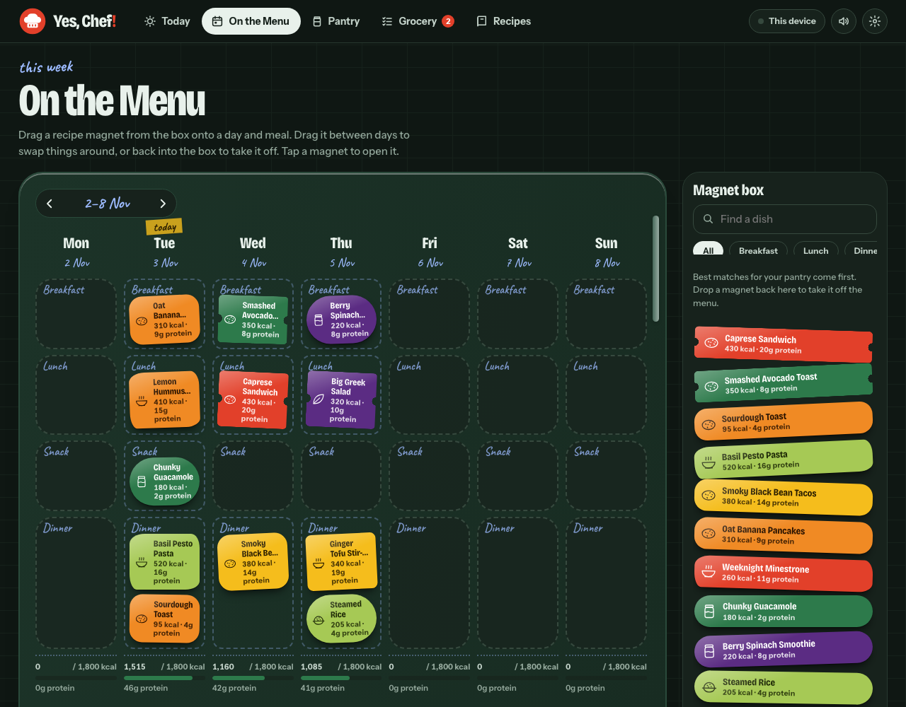
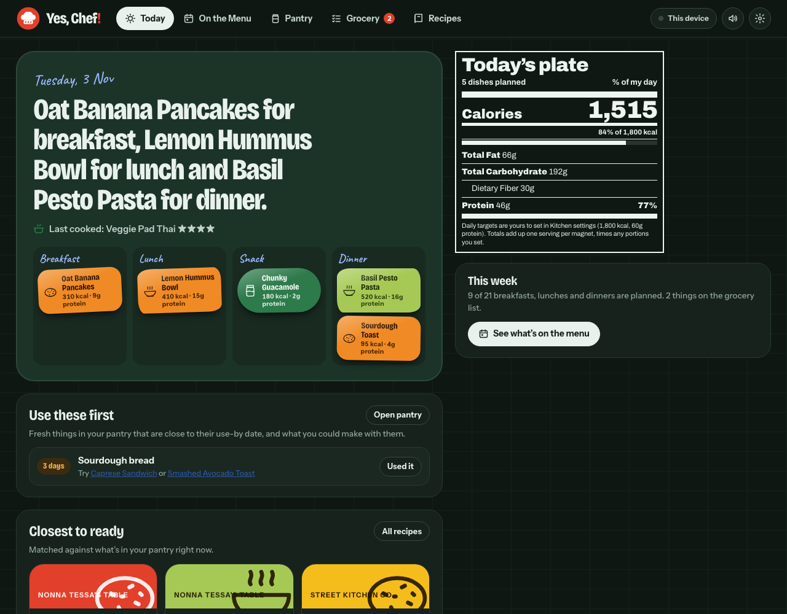
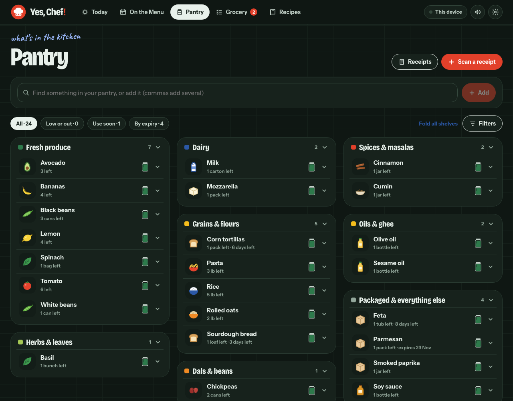
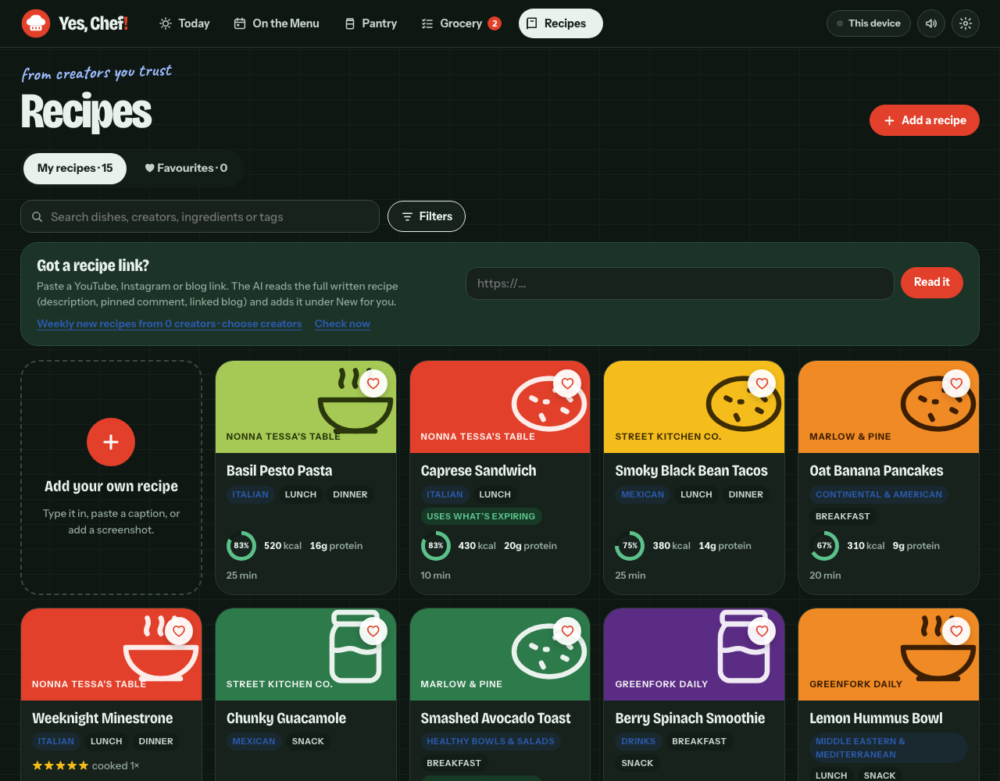

# Yes, Chef!

A meal planner, pantry tracker and recipe book that looks like a kitchen wall. Recipes are die-cut fridge magnets you drag onto a weekly plan, the pantry is a shelf of tins with stock levels and use-by dates, and every dish comes with an FDA-style nutrition label.

It is one HTML file. No server, no sign-up, no build step: your data stays in your browser.

**[Try the live demo](https://priyanshishah98.github.io/Yes-Chef/)**. The first visit loads made-up sample data so you can click around. Everything you add stays on your device.



## Why I built it
Most meal planners are a list of recipes. Cooking at home is really about three questions: *what do I already have, what should I cook this week, and what do I need to buy?* Yes, Chef! keeps those three in one place, so food gets used before it spoils and the grocery list writes itself.

## What it does

### Today
- A one-screen summary of the day: what is planned for each meal, a nutrition label for "Today's plate", and how the week is going.
- "Use these first" shows pantry items close to their use-by date and suggests dishes that would use them up.
- "Closest to ready" ranks recipes by how much of the ingredient list is already in the pantry.



### On the Menu (weekly planner)
- Drag recipe "magnets" from the magnet box onto any day and meal: breakfast, lunch, snack or dinner.
- Drag between days to swap meals, or drop a magnet back in the box to take it off.
- The magnet box sorts by best match for your pantry, so dishes you can cook now come first.
- A running nutrition total for each day, and undo for every change.

### Pantry



- Every ingredient is a tin with a stock level (full, half, low or out), an amount and a unit, grouped on shelves such as produce, dairy, grains and spices.
- Use-by dates highlight what should be cooked soon, so nothing gets forgotten at the back of the fridge.
- Items that run out are added to the grocery list automatically.

### Grocery notepad
- A paper-style list grouped by store section, with a reason beside each item (for example "ran out" or "for pancakes").
- Tick items off as you shop. Scanning a receipt (needs AI) stocks the pantry and ticks the list for you.

### Recipes



- A library of starter recipes plus your own, with ingredients, steps, servings, cooking time and cuisine.
- Filter by meal, cuisine, creator, favourites, "can cook now" (everything is in the pantry) and "cooked before".
- Make your own version of any recipe without losing the original.
- Credit the creator or channel a recipe came from, and keep the link.
- Optional dietary swap flags: the app highlights ingredients you avoid (for example onion, garlic or root vegetables) and suggests a swap, instead of hiding the recipe.

### Cook log and ratings
- Rate a dish out of five stars after cooking it, add a note, and see what you have cooked before.

### Nutrition labels
- FDA-style labels per serving, per dish and per day, with calorie and protein goals you can change.
- Each label says where the numbers came from: the creator, the ingredients, USDA values or your own entry.

### Receipts and imports (needs AI)
- Receipt scanning and reading a recipe from a link, caption or photo use an AI model. They are switched off in this standalone demo, and the forms can still be filled in by hand.

## How it works
- **One file.** HTML, CSS and JavaScript live together in `index.html`.
- **One state object.** All data (pantry, plan, grocery, recipes, log, settings) is a single JavaScript object saved to `localStorage` on every change.
- **Ingredient matching.** Names are normalised through a dictionary of synonyms and plurals, so "cilantro" and "coriander leaves", "garbanzos" and "chickpeas", or "courgette" and "zucchini" are treated as one ingredient. This is what makes "can cook now" and the automatic grocery list work.
- **Demo mode.** With no saved data and no host app, the page loads sample data and shows a notice. Clear your browser's site data to see it again.
- **Calm by design.** Animations respect the "reduce motion" setting, sound effects can be turned off, and there are light and dark themes.

## Design
The look is a kitchen wall: backsplash tiles, a mint enamel fridge, and magnets in chili, turmeric, herb and plum. Type is Bricolage Grotesque for headings, Instrument Sans for text and Caveat for handwritten notes.

## Run it yourself
There is nothing to install.

```
open index.html        # macOS; or just double-click the file
```

To serve it locally instead:

```
python3 -m http.server 8000
```

then visit http://localhost:8000.

## Project layout
```
index.html    the whole app
docs/         screenshots used in this README
AGENTS.md     short guide for coding agents
LICENSE       MIT
```

## Notes
All recipes, creators, pantry items and plans in the demo are invented sample data. Creator names are fictional and recipes are original, simple dishes written for the demo.

## License
MIT. See [LICENSE](LICENSE).
